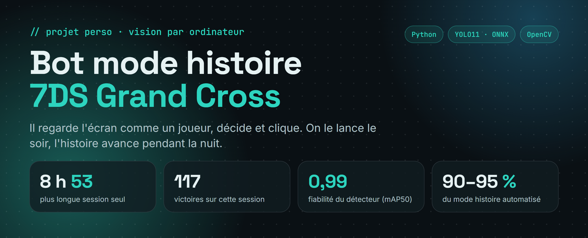
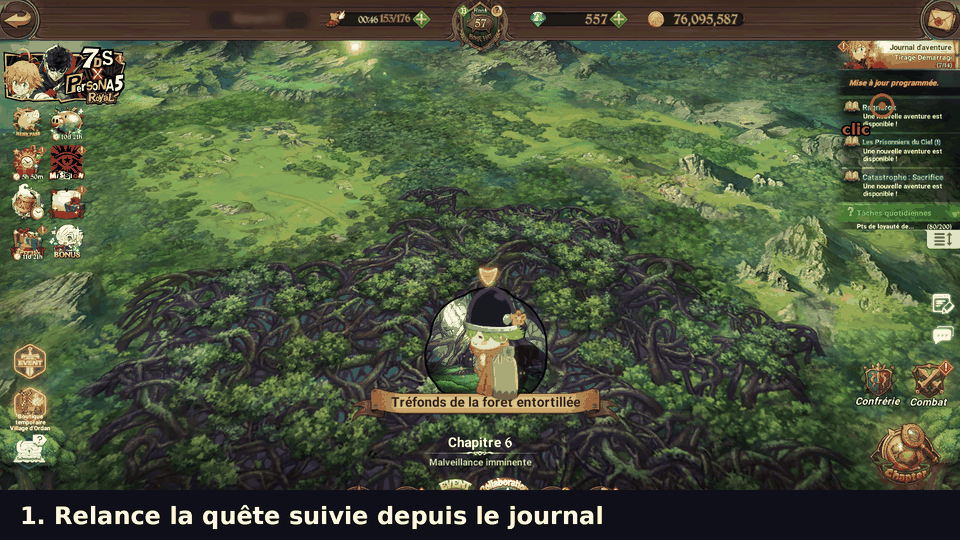
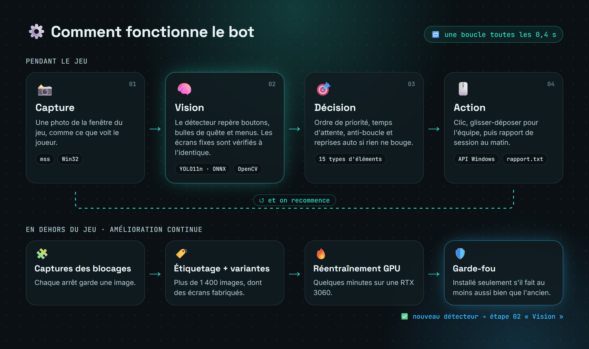

<p align="center">
  
</p>

<p align="center">
  
  
  
  
  
</p>

> 🤖 Un bot qui joue **tout seul au mode histoire** de *The Seven Deadly Sins: Grand Cross* (client PC Netmarble).
> Il **regarde l'écran comme un joueur** : un détecteur YOLO repère les boutons, les bulles de quête et les menus, le bot décide et clique. Il ne lit ni ne modifie rien dans le jeu.

Projet personnel d'**Amir Chouchane**, étudiant en BTS SIO.

<p align="center"></p>

## 📊 Résultats

| | |
| --- | --- |
| ⏱️ Plus longue session sans intervention | **8 h 53**, avec 117 victoires et 64 récompenses de quête |
| 🎯 Fiabilité du détecteur | **0,99** (mAP50 sur 180 vraies captures de contrôle) |
| 📖 Mode histoire automatisé | **environ 90 à 95 %** (voir [Limites](#️-limites)) |
| ⚡ Analyse d'un écran | environ **0,1 à 0,2 s** sur un processeur ordinaire |

## ✨ Ce qu'il fait

- 🗺️ **Suit la quête** du journal (principale ou secondaire) et parle aux personnages
- 💬 **Passe les dialogues** et les cinématiques, même pendant les attaques spéciales
- 🛡️ **Compose l'équipe** : *Choix auto*, puis place les héros imposés par la quête **sans toucher à tes 4 meilleurs persos**
- ⚔️ **Lance les combats**, valide les victoires, ramasse les récompenses, utilise une potion d'endurance si besoin
- 🔁 **Se débloque tout seul** : reprise automatique, anti-boucle, fausses bulles ignorées
- 📝 **Rapport de session** le matin (`rapport.txt`) : durée, combats, victoires, arrêts et leur cause

## 🚀 Installation

> 📘 Tutoriel pas à pas, sans connaissance en informatique : **[TUTO.md](TUTO.md)**

1. 🐍 Installer [Python](https://www.python.org/downloads/) en cochant **« Add python.exe to PATH »**
2. 📦 **Code → Download ZIP**, puis décompresser
3. 🛠️ Double-cliquer sur **`INSTALLER.bat`** (une seule fois)
4. 🎮 Lancer le jeu en **1920 × 1080, en français**, puis **clic droit sur `0_LANCER.bat` → Exécuter en tant qu'administrateur**

Au premier lancement, le bot demande quelle quête suivre. **Une seule fois**, ouvre un écran d'équipe avec tes 4 meilleurs persos et appuie sur **F11**.

## ⌨️ Touches

| Touche | Action |
| :---: | --- |
| **F8** | ⏯️ Pause / reprise |
| **F9** | ⏹️ Quitter (écrit le rapport) |
| **F11** | 🛡️ Enregistrer son équipe |
| **F12** | 🔀 Quête principale ↔ secondaire |
| **F6** | 📸 Capture d'écran |
| **F7** | 🎯 Changer l'endroit du « clic dans le vide » |
| **F10** | 🔍 Diagnostic : ce que le bot reconnaît |

## ⚙️ Comment ça marche

<p align="center"></p>

- 🧠 **Détecteur YOLO11n** entraîné sur 15 types d'éléments et exporté en **ONNX** : il tourne sans carte graphique
- 🖼️ **Comparaison d'image exacte** (OpenCV) pour les écrans qui ne changent jamais : victoire, défaite, SKIP, combat, héros requis
- 🔄 **Amélioration continue** : chaque blocage donne une capture, qui est étiquetée puis sert à réentraîner le détecteur. Un **garde-fou** ne l'installe que s'il fait au moins aussi bien que l'ancien ([`outils/`](outils/))

## ⚠️ Limites

- 📖 **90 à 95 % du mode histoire, pas 100 %** : la cuisine, certaines quêtes spéciales et les combats trop durs se font à la main. Le bot s'arrête alors proprement, avec une capture.
- 🖥️ Testé uniquement sur le **client PC officiel, en français, en 1920 × 1080**, sous Windows 10 et 11.
- 🌙 Pour la nuit : pas de mise en veille ni de verrouillage (éteindre l'écran, c'est OK).

## ⚖️ Avertissement

Projet personnel d'apprentissage en vision par ordinateur et en automatisation. **Utiliser un bot est contraire aux conditions d'utilisation du jeu** et peut entraîner une sanction du compte : chacun l'utilise sous sa propre responsabilité. Ce projet n'est ni affilié à Netmarble ni approuvé par l'éditeur.

## 🛠️ Technologies

| | |
| --- | --- |
| Langage | Python 3 |
| Vision | YOLO11n (Ultralytics), ONNX Runtime, OpenCV, NumPy |
| Capture et contrôle | mss, API Win32 (ctypes) |
| Entraînement | PyTorch (CUDA), images fabriquées, garde-fou de validation |

## 📁 Organisation

```
0_LANCER.bat        ▶️ Lance le bot (le seul fichier à ouvrir au quotidien)
INSTALLER.bat       🛠️ Installe les modules Python (une seule fois)
TUTO.md             📘 Installation pas à pas
_moteur/            🤖 Le bot : décisions, détecteur ONNX, modèles d'image
outils/             🔥 Étiquetage, jeu de données, réentraînement
docs/               🖼️ Bannière, démo et schéma
```

## 📬 Contact

- 💼 LinkedIn : [amir-chouchane](https://www.linkedin.com/in/amir-chouchane)
- 🐙 GitHub : [@Reiner916](https://github.com/Reiner916)
- 🌐 Portfolio : [amir-chouchane.vercel.app](https://amir-chouchane.vercel.app)
